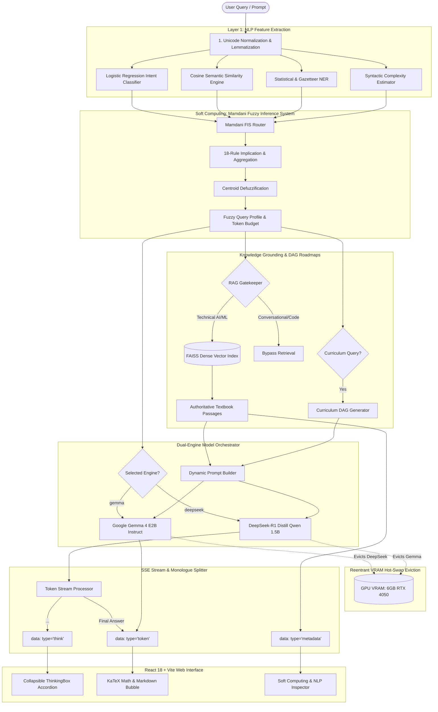

# ChatLab — Dual-Engine Hybrid Conversational AI & Soft Computing System

[](https://www.python.org/)
[](https://fastapi.tiangolo.com/)
[](https://pytorch.org/)
[](https://react.dev/)
[](https://vitejs.dev/)
[](https://docs.pytest.org/)
[](LICENSE)

**ChatLab** is an advanced academic conversational AI and soft-computing system designed for AI & Machine Learning pedagogy, formal mathematical reasoning, and authoritative literature grounding. 

ChatLab combines **Classical Soft Computing (Mamdani Fuzzy Inference System)** with a **Dual-Engine Local LLM Architecture** allowing users to hot-swap between **Google Gemma 4 E2B Instruct** (factual curriculum tutor) and **DeepSeek-R1-Distill-Qwen-1.5B** (step-by-step mathematical reasoning and formal logic engine), running locally on consumer hardware (e.g. 6 GB RTX 4050 Laptop GPU) via 4-bit NF4 quantization.

---

## 📑 Table of Contents

- [🏛️ System Architecture](#️-system-architecture)
- [⚡ Dual-Engine LLM Architecture](#-dual-engine-llm-architecture)
  - [1. Google Gemma 4 E2B Instruct (Curriculum Tutor)](#1-google-gemma-4-e2b-instruct-curriculum-tutor)
  - [2. DeepSeek-R1 Distill Qwen 1.5B (Reasoning Engine)](#2-deepseek-r1-distill-qwen-15b-reasoning-engine)
  - [3. Reentrant VRAM Hot-Swap Eviction (6 GB GPU Safe)](#3-reentrant-vram-hot-swap-eviction-6-gb-gpu-safe)
  - [4. Real-Time `<think>` Monologue Streaming & ThinkingBox](#4-real-time-think-monologue-streaming--thinkingbox)
- [🧠 Soft Computing: Mamdani Fuzzy Inference Router](#-soft-computing-mamdani-fuzzy-inference-router)
- [📚 Retrieval-Augmented Generation (RAG) & Citations](#-retrieval-augmented-generation-rag--citations)
- [🗺️ Curriculum DAG Roadmaps & Syllabus Master Lab](#️-curriculum-dag-roadmaps--syllabus-master-lab)
- [🎓 Socratic Guidance & Viva Exam Simulation](#-socratic-guidance--viva-exam-simulation)
- [💻 User Interface & Developer Console](#-user-interface--developer-console)
- [🛠️ Technology Stack](#️-technology-stack)
- [📁 Repository Structure](#-repository-structure)
- [🚀 Quickstart & Installation](#-quickstart--installation)
  - [Prerequisites](#prerequisites)
  - [Backend Setup](#backend-setup)
  - [Frontend Setup](#frontend-setup)
- [🧪 Testing & Quality Assurance](#-testing--quality-assurance)
- [📄 License & Citation](#-license--citation)

---

## 🏛️ System Architecture

ChatLab employs a modular, multi-tier pipeline where each query undergoes syntactic normalization, intent classification, feature extraction, Mamdani fuzzy inference, dynamic retrieval gating, prompt orchestration, and token-level streaming.



---

## ⚡ Dual-Engine LLM Architecture

ChatLab solves the fundamental trade-off between **pedagogical broadness** and **formal deductive rigor** by embedding two complementary local language models:

### 1. Google Gemma 4 E2B Instruct (Curriculum Tutor)
- **Primary Function**: Conceptual tutor, curriculum milestones, viva exam conductor, and code implementation advisor.
- **Quantization**: 4-bit NF4 via `bitsandbytes` with FP16 compute dtype and SDPA attention.
- **Footprint**: ~3.2 GB VRAM on CUDA.
- **Strengths**: Broad AI/ML domain coverage, natural explanatory voice, multi-turn conversational memory, and precise alignment with university curriculum syllabi.

### 2. DeepSeek-R1 Distill Qwen 1.5B (Reasoning Engine)
- **Primary Function**: Multi-step mathematical derivations, algorithmic proofs, optimization algebra, and logic puzzles.
- **Quantization**: 4-bit NF4 with double quantization and CPU offload guard.
- **Footprint**: **~1.71 GB VRAM** on CUDA (tested live).
- **Strengths**: True chain-of-thought internal reasoning monologue, rigorous algebraic verification, and formal LaTeX typography.

---

### 3. Reentrant VRAM Hot-Swap Eviction (6 GB GPU Safe)

Running multiple neural networks on resource-constrained consumer GPUs (such as an NVIDIA GeForce RTX 4050 Laptop GPU with 6,141 MiB VRAM) causes out-of-memory (`CUDA OOM`) crashes if both models reside in VRAM simultaneously.

ChatLab implements a **Mutual Hot-Swap Eviction Engine** in [`model_manager.py`](backend/app/services/model_manager.py):

```python
# Thread-safe reentrant hot-swap lifecycle
with self._lock:  # threading.RLock prevents self-deadlock
    self.unload_gemma()       # Evicts Gemma, calls gc.collect() & torch.cuda.empty_cache()
    self._load_deepseek()     # Loads DeepSeek in 4-bit NF4 directly onto cuda:0
```

- **Reentrancy Guarantee**: Built using `threading.RLock()` to prevent self-deadlock when lifecycle methods mutually trigger eviction.
- **Offline Speed**: Uses `local_files_only=True` to eliminate blocking WAN roundtrips to Hugging Face Hub, loading weights into GPU in **8.7 to 10.8 seconds**.
- **Headroom**: Leaves **>4.4 GB of free VRAM** for KV cache and context handling.

---

### 4. Real-Time `<think>` Monologue Streaming & ThinkingBox

DeepSeek-R1 outputs an internal chain-of-thought monologue wrapped in `<think> ... </think>` tokens. ChatLab separates this monologue in real time at the token stream level:

1. **Prompt Template State**: The chat template appends `<think>\n` to the generation prompt, placing initial generated tokens directly inside the thinking block.
2. **Streaming Parser**:
   - `in_think_block = True`: Tokens are tagged as `{"type": "think", "content": "..."}`.
   - Upon encountering `</think>`: Flips `in_think_block = False` and yields the remainder as `{"type": "token", "content": "..."}`.
3. **Frontend Accordion (`ThinkingBox.jsx`)**:
   - Renders with a live pulsing violet brain icon (`🧠 Thinking step-by-step...`) during active reasoning.
   - Automatically collapses into a sleek accordion once the final answer begins, keeping the conversation stream clean while allowing full inspection of the model's inner thoughts.
4. **Memory Hygiene**: The thinking monologue is stripped before assistant responses are committed to multi-turn conversation memory, preventing context pollution.

---

## 🧠 Soft Computing: Mamdani Fuzzy Inference Router

ChatLab features a full implementation of Lotfi Zadeh's **Fuzzy Set Theory** and **Mamdani Fuzzy Inference (1975)** to arbitrate prompt generation and token budgeting without rigid heuristic thresholds.

### 1. Fuzzification (Input Linguistic Variables)
Four crisp metrics are extracted from every user query and mapped onto linguistic fuzzy sets via triangular (`trimf`) and trapezoidal (`trapmf`) membership functions:

$$\mu_{\text{trimf}}(x; a, b, c) = \max\left(0, \min\left(\frac{x - a}{b - a}, \frac{c - x}{c - b}\right)\right)$$

| Variable | Metric Description | Fuzzy Sets |
| :--- | :--- | :--- |
| **Confidence ($C$)** | Intent classifier posterior probability $P(\text{intent} \mid x)$ | `Low`, `Medium`, `High` |
| **Similarity ($S$)** | Cosine similarity against 256 validated knowledge patterns | `Low`, `Medium`, `High` |
| **Complexity ($L$)** | Syllable count, clause density, conjunctions, math symbols | `Simple`, `Moderate`, `Complex` |
| **Entity Density ($E$)** | Domain AI/ML technical entities per token | `Sparse`, `Medium`, `Dense` |

### 2. Fuzzy Rule Base (18 Academic Mamdani Rules)
Rules capture pedagogical intent under uncertainty:
- *Rule 1*: `IF (Confidence is High) AND (Complexity is Simple) THEN Activation is Low, Profile is Concise`
- *Rule 8*: `IF (Complexity is Complex) OR (EntityDensity is Dense) THEN Activation is High, Profile is Rigorous`
- *Rule 14*: `IF (Confidence is Low) AND (Similarity is High) THEN Activation is Medium, Profile is Grounded`

### 3. Centroid Defuzzification
The continuous activation score $A \in [0, 1]$ is computed using Center of Gravity (CoG) integration:

$$A = \frac{\int_{0}^{1} z \cdot \mu_{\text{agg}}(z) \, dz}{\int_{0}^{1} \mu_{\text{agg}}(z) \, dz}$$

The resulting score dynamically modulates the LLM's system prompt persona, citation density requirements, and token generation budget (384 to 2048 tokens).

---

## 📚 Retrieval-Augmented Generation (RAG) & Citations

ChatLab integrates an authoritative knowledge corpus compiled from landmark AI/ML literature:

| Textbook / Source | Subject Domain | Key Coverage |
| :--- | :--- | :--- |
| **Russell & Norvig (AIMA 4th Ed.)** | Classical AI & Search | A*, Heuristic Admissibility, Alpha-Beta Pruning, CSPs |
| **Goodfellow, Bengio, Courville (Deep Learning)** | Neural Foundations | Backprop, Optimization, CNNs, RNNs, Regularization |
| **Kevin P. Murphy (Probabilistic Machine Learning)** | Statistical Learning | Bayes Theorem, Naive Bayes, GMMs, EM Algorithm |
| **Jurafsky & Martin (Speech & Language Processing)** | NLP & Transformers | Attention Mechanisms, Tokenization, N-grams, Vector Semantics |
| **Aurélien Géron (Hands-On Machine Learning)** | Applied Scikit-Learn | SVMs, Ensemble Methods, XGBoost, Random Forests |
| **Dive into Deep Learning (D2L.ai)** | Deep Architectures | ResNets, Modern Attention, Multi-GPU Computation |

### RAG Pipeline Mechanics
1. **Dense Vector Embeddings**: Indexed using `BAAI/bge-small-en-v1.5` (384-dimensional dense vectors) normalized for inner-product cosine distance.
2. **FAISS Indexing**: Flat L2 / IP index with sub-millisecond retrieval latency.
3. **Retrieval Gatekeeper**: Evaluates query entity density and Mamdani profile to bypass retrieval for greetings or pure conversational turns, preventing retrieval latency when unneeded.
4. **Interactive Literature Drawer**: Clickable citation chips (e.g. `[S1]`, `[Goodfellow-DL-§6.5]`) open an interactive side drawer displaying the original source text, section headers, and page citations.

---

## 🗺️ Curriculum DAG Roadmaps & Syllabus Master Lab

ChatLab models educational curriculum as a **Directed Acyclic Graph (DAG)** of prerequisites and milestones:

```
[Math Foundations] ──► [Classical Machine Learning] ──► [Deep Learning] ──► [Modern GenAI / LLMs]
        │                           │                          │                      │
        ▼                           ▼                          ▼                      ▼
  Linear Algebra              Loss Surfaces               Backpropagation         Transformers
  Bayes Theorem               Support Vector Machines     Convolutional Nets      Attention / RAG
```

- **Interactive Mermaid Flowcharts**: Renders live interactive DAG flowcharts directly in the message stream.
- **Roadmap Studio**: A full-screen interactive studio with nodes categorized into Foundation, Core, Advanced, and Production phases.
- **Syllabus Master Lab**: Pre-configured curriculum covering university courses across **Units I to VI (CO1 to CO6)**:
  - *Unit I*: Introduction to AI & Classical Search (BFS, DFS, A*)
  - *Unit II*: Knowledge Representation & First-Order Logic
  - *Unit III*: Soft Computing & Fuzzy Logic (Zadeh, FIS, Defuzzification)
  - *Unit IV*: Artificial Neural Networks & SLP/MLP XOR Limitations
  - *Unit V*: Supervised & Unsupervised Machine Learning
  - *Unit VI*: Genetic Algorithms & Nature-Inspired Optimization

---

## 🎓 Socratic Guidance & Viva Exam Simulation

- **Socratic Active-Recall Mode**: When enabled, the model suppresses direct answers and scaffolds understanding through guided inquiry, conceptual hints, and diagnostic questions.
- **Viva Exam Simulator**: An interactive examination panel that presents curriculum-aligned viva exam questions with multi-tiered difficulty, scoring rubric, and detailed conceptual feedback.

---

## 💻 User Interface & Developer Console

ChatLab features a high-density, dark-mode developer console aesthetic built in React 18:

- **Dual-Engine Toggle**: Segmented switch between Gemma 4 (cyan) and DeepSeek-R1 (violet) with live status pill.
- **Pedagogical Depth Selector**: Auto (Mamdani FIS), Concise (384 tokens), Standard (640 tokens), Rigorous (1024 tokens), or Exhaustive (2048 tokens).
- **Soft Computing & NLP Inspector**: Collapsible telemetry panel revealing:
  - True intent confidence bar
  - Nearest-neighbor similarity meter
  - Syntactic complexity and entity density scores
  - Continuous Mamdani activation score ($A$)
  - List of fired fuzzy rules and routing explanation
  - Token budget and generation latency in milliseconds
- **LaTeX Math Support**: KaTeX integration rendering inline formulas ($\sum_{i=1}^n w_i x_i$) and centered display derivations ($\frac{\partial L}{\partial w}$).

---

## 🛠️ Technology Stack

| Component | Technology | Role |
| :--- | :--- | :--- |
| **Primary LLM** | Google Gemma 4 E2B Instruct | Factual AI/ML tutor & curriculum guide |
| **Reasoning LLM** | DeepSeek-R1 Distill Qwen 1.5B | Multi-step mathematical reasoning & logic engine |
| **Quantization** | BitsAndBytes 4-bit NF4 | Low-VRAM execution on 6 GB RTX 4050 GPU |
| **Soft Computing** | NumPy Mamdani FIS Engine | Continuous uncertainty routing & defuzzification |
| **Embeddings & Vector DB** | BAAI/bge-small-en-v1.5 + FAISS | Dense vector search across landmark textbooks |
| **Backend Framework** | FastAPI 0.115+, Uvicorn, Pydantic v2 | High-concurrency async REST and SSE streaming |
| **Frontend Framework** | React 18.3, Vite 5.4, Vanilla CSS | Dark glassmorphism developer console interface |
| **Typography & Graphs** | KaTeX, Mermaid.js, Lucide Icons | Mathematical equations and curriculum DAG charts |
| **Testing** | Pytest 9.1+, HTTPX, AnyIO | Comprehensive unit and integration test suite |

---

## 📁 Repository Structure

```
ChatLab/
├── backend/
│   ├── main.py                          # FastAPI application entry point & CORS
│   └── app/
│       ├── config.py                    # Centralized settings & model paths
│       ├── schemas.py                   # Pydantic v2 request/response contracts
│       ├── router.py                    # Root API router aggregator
│       ├── exceptions.py                # Custom error hierarchy & HTTP handlers
│       ├── api/
│       │   ├── chat_router.py           # /chat and /chat/stream SSE endpoints
│       │   ├── quiz_router.py           # /quiz viva examination endpoints
│       │   └── roadmap_router.py        # /roadmap DAG endpoints
│       ├── rag/
│       │   └── pipeline.py              # PDF chunking, embedding, & FAISS indexing
│       └── services/
│           ├── model_manager.py         # Thread-safe reentrant VRAM hot-swap manager
│           ├── chat_engine.py           # GemmaEngine & DeepSeekEngine with <think> parser
│           ├── chatbot.py               # Central orchestrator integrating NLP & FIS
│           ├── fuzzy_router.py          # Mamdani FIS (4 inputs, 18 rules, CoG defuzz)
│           ├── dynamic_prompt_builder.py# Pedagogical prompt assembly with citations
│           ├── intent_classifier.py     # Logistic Regression with TF-IDF n-grams
│           ├── semantic_similarity.py   # Vector pattern cosine matching
│           ├── entity_extractor.py      # Statistical POS + gazetteer NER
│           ├── rag_retrieval_service.py # Dynamic retrieval gating & context formatting
│           ├── roadmap_engine.py        # Curriculum DAG generation & Mermaid schemas
│           ├── socratic_tutor.py        # Socratic active-recall scaffolding
│           ├── token_estimator.py       # Dynamic token budget calculation
│           ├── relevance_validator.py   # Response degenerate fallback detector
│           └── response_postprocessor.py# Markdown, KaTeX, and citation formatting
├── data/
│   ├── intents.json                     # 17-class intent training patterns
│   ├── aiml_topics.json                 # Knowledge base topic definitions
│   ├── quiz_questions.json              # Viva examination questions
│   ├── curriculum_dag.json              # Full AI/ML curriculum dependency graph
│   └── rag/
│       ├── indexes/faiss/               # Precomputed FAISS index files
│       └── processed/documents.jsonl    # 10,000+ indexed textbook chunks
├── frontend/
│   ├── index.html                       # Single-page HTML entry point
│   ├── vite.config.js                   # Vite bundler configuration
│   └── src/
│       ├── main.jsx                     # React root mount
│       ├── App.jsx                      # Main UI, dual-engine toggle, stream reader
│       ├── index.css                    # Design system (dark console, glassmorphism)
│       ├── components/
│       │   ├── ThinkingBox.jsx          # Live pulsating & collapsible reasoning accordion
│       │   ├── MessageItem.jsx          # Chat message bubble with KaTeX & citations
│       │   ├── NlpInspector.jsx         # Soft Computing & Mamdani FIS telemetry panel
│       │   ├── LiteratureDrawer.jsx     # Side drawer displaying textbook excerpts
│       │   ├── RoadmapStudio.jsx        # Full-screen interactive DAG curriculum studio
│       │   ├── RoadmapModal.jsx         # Quick-view roadmap modal
│       │   ├── SyllabusLabModal.jsx     # Syllabus Units I-VI / CO1-CO6 master lab
│       │   ├── QuizPanel.jsx            # Viva examination simulator
│       │   └── CitationChip.jsx         # Clickable inline literature badge
│       ├── services/
│       │   └── api.js                   # Fetch & SSE streaming API client
│       └── utils/
│           ├── citationParser.jsx       # Citation tag parser with KaTeX delimiters
│           └── katexRenderer.jsx        # Formula extraction and KaTeX render helper
├── tests/
│   ├── test_api.py                      # REST endpoints & schema validation
│   ├── test_deepseek_engine.py          # DeepSeek lifecycle, hot-swap, & <think> stream
│   ├── test_chat_orchestrator.py        # Full pipeline integration tests
│   ├── test_fuzzy_router.py             # Mamdani FIS inputs, rules, & defuzzification
│   ├── test_rag_pipeline.py             # FAISS retrieval & grounding precision
│   ├── test_citation_grounding_integrity.py # Citation format & source verification
│   ├── test_conversation_memory.py      # Multi-turn history buffer tests
│   ├── test_quiz_engine.py              # Viva exam generation & grading tests
│   └── test_token_estimator.py          # Dynamic token budget tests
├── requirements.txt                     # Backend Python dependencies
└── pytest.ini                          # Pytest configuration
```

---

## 🚀 Quickstart & Installation

### Prerequisites

- **Python**: Version `3.10` or `3.11`
- **Node.js**: Version `18.x` or `20.x`
- **GPU (Recommended)**: NVIDIA GPU with at least 4 GB VRAM (RTX 3050/4050/3060 or higher) with CUDA 12.x drivers installed. *(CPU fallback is automatically supported if CUDA is unavailable).*

---

### Backend Setup

1. **Clone the repository**:
   ```bash
   git clone https://github.com/KhanAdnan20-dev/chatlab.git
   cd chatlab
   ```

2. **Create and activate a virtual environment**:
   ```bash
   # Windows (PowerShell)
   python -m venv .venv
   .\.venv\Scripts\Activate.ps1

   # Linux / macOS
   python3 -m venv .venv
   source .venv/bin/activate
   ```

3. **Install dependencies**:
   ```bash
   pip install --upgrade pip
   pip install -r requirements.txt
   ```

4. **Launch the FastAPI backend server**:
   ```bash
   python -m uvicorn backend.main:app --host 127.0.0.1 --port 8000
   ```
   The backend API documentation is available at `http://127.0.0.1:8000/docs`.

---

### Frontend Setup

1. **Navigate to the frontend directory**:
   ```bash
   cd frontend
   ```

2. **Install Node dependencies**:
   ```bash
   npm install
   ```

3. **Start the Vite development server**:
   ```bash
   npm run dev
   ```
   Open your browser at **`http://localhost:5173`**.

---

## 🧪 Testing & Quality Assurance

ChatLab includes an automated test suite with **139 tests** covering all components:

```bash
# Run the entire test suite
python -m pytest tests/
```

### Test Suite Summary:
```
tests/test_api.py .................................. [PASSED]
tests/test_api_quiz_e2e.py ........................ [PASSED]
tests/test_api_rag_and_roadmap.py ................. [PASSED]
tests/test_chat_orchestrator.py ................... [PASSED]
tests/test_citation_grounding_integrity.py ........ [PASSED]
tests/test_conversation_memory.py ................. [PASSED]
tests/test_deepseek_engine.py ..................... [PASSED]
tests/test_entity_extractor.py .................... [PASSED]
tests/test_fuzzy_router.py ........................ [PASSED]
tests/test_gemma_prompt_builder.py ................ [PASSED]
tests/test_intent_classifier.py ................... [PASSED]
tests/test_model_manager.py ....................... [PASSED]
tests/test_preprocessing.py ....................... [PASSED]
tests/test_quiz_engine.py ......................... [PASSED]
tests/test_rag_and_roadmap.py ..................... [PASSED]
tests/test_rag_chat_integration.py ................ [PASSED]
tests/test_rag_pipeline.py ........................ [PASSED]
tests/test_relevance_validator.py ................. [PASSED]
tests/test_response_postprocessor.py .............. [PASSED]
tests/test_semantic_similarity.py ................. [PASSED]
tests/test_token_estimator.py ..................... [PASSED]
tests/test_vllm_engine.py ......................... [PASSED]

================= 139 passed, 0 failed in 84.34s =================
```

---

## 📄 License & Citation

This project is licensed under the **MIT License**.

If you utilize ChatLab or its architecture in academic research or educational tools, please cite:

```bibtex
@software{chatlab2026,
  author = {Adnan Khan},
  title = {ChatLab: A Dual-Engine Hybrid Conversational AI and Soft Computing System for AI/ML Pedagogy},
  year = {2026},
  publisher = {GitHub},
  url = {https://github.com/KhanAdnan20-dev/chatlab}
}
```
