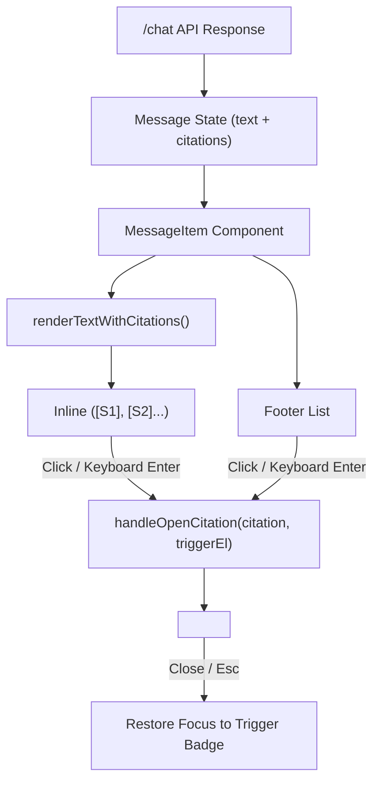

# ChatLab System Architecture

## 1. Project Overview & Objective
**ChatLab** is an academic mini-project demonstrating a **modular, hybrid conversational AI architecture**. The overarching vision is to combine deterministic/statistical Natural Language Processing (Layer 1) with an open-source Large Language Model (Layer 2) managed by an intelligent decision router.

In this foundational phase, **Layer 1 (Advanced NLP Layer)** is fully implemented, verified, and operational, while establishing clean interfaces for future Layer 2 integration.

---

## 2. High-Level Architectural Diagram

```
                              ┌────────────────────────────────┐
                              │         USER / CLIENT          │
                              │ (React + Vite Web Interface)   │
                              └───────────────┬────────────────┘
                                              │ HTTP POST /chat
                                              ▼
                              ┌────────────────────────────────┐
                              │     FastAPI Gateway Server     │
                              │  (Validation, CORS, Routing)   │
                              └───────────────┬────────────────┘
                                              │
                                              ▼
                              ┌────────────────────────────────┐
                              │   Chatbot Orchestration Core   │
                              │   (backend/app/services/...)   │
                              └───────┬──────────────┬─────────┘
                                      │              │
                   ┌──────────────────┘              └──────────────────┐
                   ▼                                                    ▼
       ┌────────────────────────┐                           ┌────────────────────────┐
       │     Preprocessing      │                           │   Entity Extraction    │
       │  - Unicode & Whitespace│                           │  - POS Tagging         │
       │  - Lowercasing         │                           │  - NLTK ne_chunk       │
       │  - Tokenization        │                           │  - Domain Gazetteer    │
       │  - Lemmatization       │                           └────────────────────────┘
       └───────────┬────────────┘
                   ▼
       ┌────────────────────────┐
       │ Intent Classification  │
       │  - Word + Char TF-IDF  │
       │  - Logistic Regression │
       │  - predict_proba()     │
       └───────────┬────────────┘
                   │
                   ▼
       ┌────────────────────────┐
       │  Semantic Similarity   │
       │  - Dense TF-IDF Space  │
       │  - Cosine Similarity   │
       │  - Pattern Rescue      │
       └───────────┬────────────┘
                   │
                   ▼
       ┌────────────────────────────────────────────────────────┐
       │                  Layer Routing Decision                │
       │  - Confidence >= Threshold? ──► [Layer 1 Response]     │
       │  - Low Confidence / Unknown? ─► [Layer 2 Fallback]     │
       └────────────────────────────────────────────────────────┘
```

---

## 3. Layer 1 Pipeline Components

### 3.1 Preprocessing (`preprocessing.py`)
- **Text Normalization**: Strips accents, lowers case, and collapses whitespace.
- **Tokenization**: Regex-based alphanumeric token extraction preserving contractions and domain terms.
- **Lemmatization**: WordNet-based morphological reduction to base lemmas.
- **Duality Preservation**: Retains `original_text` for NER span offsets alongside `processed_text` for statistical ML models.

### 3.2 Machine Learning Intent Classification (`intent_classifier.py`)
- **Algorithm**: Multi-class `LogisticRegression` with balanced class weights.
- **Feature Extraction**: `FeatureUnion` combining word n-grams (1-3) and character n-grams (2-5).
- **Inference**: Produces genuine calibrated probability distributions across all 17 intent classes.

### 3.3 Semantic Similarity Engine (`semantic_similarity.py`)
- **Methodology**: In-memory vectorization of all training patterns via sublinear TF-IDF and cosine distance computation.
- **Pattern Rescue**: Rescues queries that paraphrase training examples even if exact keyword combinations vary.

### 3.4 Named Entity Recognition (`entity_extractor.py`)
- **Statistical NER**: NLTK Part-of-Speech tagging and chunking for proper names and locations.
- **Domain Gazetteer**: High-precision recognition of programming languages, tools, frameworks, study techniques, and dates.

### 3.5 Response Engine (`response_engine.py`)
- **Template Variation**: Selects dynamic conversational responses from curated intent templates.

---

## 4. Layer Routing & Fallback Behavior

```
                   Confidence Score (C) & Semantic Score (S)
                                      │
              ┌───────────────────────┴───────────────────────┐
              ▼                                               ▼
     C >= 0.55 or S >= 0.40                         C < 0.55 and S < 0.40
              │                                               │
              ▼                                               ▼
       [Active Layer: Layer 1]                      [Active Layer: Fallback]
   Dispatches Curated NLP Response            "This request requires the advanced
                                            conversational model (Layer 2), not enabled yet."
```

---

## 5. End-to-End Request Flow (`POST /chat`)

1. **Client Request**: Frontend sends `{ "message": "I have a Python exam on Monday" }`.
2. **Schema Validation**: FastAPI validates input using Pydantic `ChatRequest`.
3. **Pipeline Orchestration**: `ChatbotService.process()` triggers preprocessing, ML prediction, NER extraction, and similarity calculation.
4. **Decision Evaluation**: `LayerDecision` determines that intent is `study_help` or `programming_help` with high confidence.
5. **Serialization**: Result formatted into `ChatResponse` containing response text, confidence, entities (`Python`, `Monday`), similarity score, processing latency, and structured citations (`CitationItem`).
6. **Delivery**: Client receives HTTP 200 JSON payload.

---

## 6. Phase 2B: Interactive Citation UI & Literature Drawer

Phase 2B integrates the RAG citation pipeline with the React user interface, providing interactive inline citation badges and a slide-in Literature Drawer.

### Data Flow & Component Architecture



### Key Capabilities
- **Inline Citation Mapping**: Regular expressions parse `[S1]`, `[S2]` markers in model output and convert them into `<CitationChip />` components strictly when backed by that message's structured `citations` array.
- **Unmatched Marker Safety**: Unmatched tags (e.g. `[S99]`) and bracket expressions inside code fences (``arr[S1]``) are preserved as plain text. Model output is never injected via raw HTML.
- **Accessible Literature Drawer**: Displays source title, PDF filename, physical PDF page numbers, supporting passage, and dense cosine similarity score.
- **Safe External Navigation**: Only valid `http:` and `https:` URLs are rendered as external hyperlinks; local repository textbooks display verified local attribution without file system paths.
- **Keyboard & Focus Management**: Supports `Escape` key close and restores focus to the invoking citation badge upon dismissal.

