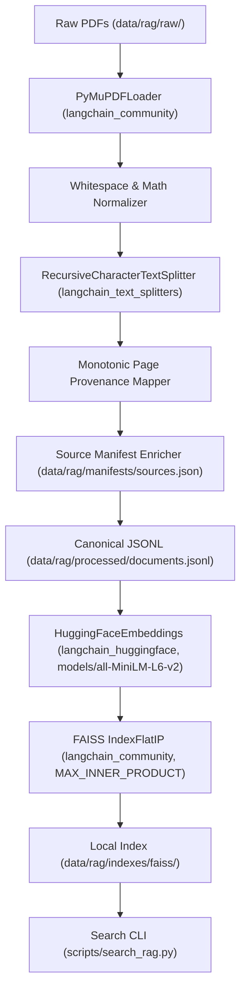
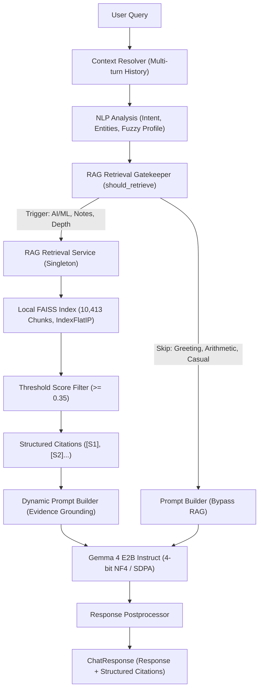

# ChatLab Grounded RAG Pipeline (Phase 1)

## Overview

ChatLab Phase 1 implements a local, deterministic, LangChain-powered Retrieval-Augmented Generation (RAG) ingestion and retrieval pipeline. It processes textbooks and literature across deep learning, machine learning, natural language processing, and mathematics into dense vector embeddings stored in a FAISS inner-product index.

---

## Architecture



---

## Core Components

### 1. Document Extraction (`PyMuPDFLoader`)
- **Library**: `langchain_community.document_loaders.PyMuPDFLoader` (backed by `pymupdf`).
- **Discovery**: Recursively discovers all `.pdf` files under `data/rag/raw/`.
- **Handling**: Handles malformed or unreadable files gracefully; reports pages with zero extractable text (OCR required) without fabricating content.

### 2. Text Normalization
- **Indentation Preservation**: Preserves code blocks (e.g. 4-space indentation) and mathematical notation.
- **Symbol Preservation**: Preserves $\LaTeX$, Unicode math symbols ($\in, \sum, \nabla$), equations, and subscripts.
- **Whitespace Cleanup**: Normalizes excessive internal whitespace and collapses $\ge 3$ consecutive newlines to 2.

### 3. Chunking Strategy (`RecursiveCharacterTextSplitter`)
- **Word Target**: Configurable target of ~220 words (`length_function=lambda t: len(t.split())`).
- **Overlap**: Configurable overlap of ~40 words.
- **Separators**: `["\n\n", "\n", ". ", " ", ""]`.
- **Deterministic**: Pure deterministic splitting ensuring reproducibility across runs.

### 4. Monotonic Page Provenance
- Tracks chunk substrings monotonically through the document's character span.
- Determines physical 1-based PDF pages (`page_start`, `page_end`) for all chunks, including multi-page boundary crossings.
- Completely avoids LangChain's internal character-versus-word offset calculation bug.

### 5. Embeddings & Vector Store
- **Embedding Model**: Local pre-warmed `models/all-MiniLM-L6-v2`.
- **Normalization**: L2 normalized embeddings so that Inner Product equals Cosine Similarity.
- **Vector Store**: `FAISS` using `DistanceStrategy.MAX_INNER_PRODUCT` (`faiss.IndexFlatIP`).
- **Persistence**: Safe writing via staging directory before atomic commitment.

---

## Data Artifacts

| Path | Format | Description |
| :--- | :--- | :--- |
| `data/rag/processed/documents.jsonl` | UTF-8 JSONL | Canonical chunk records with full metadata, page bounds, and SHA-256 hashes |
| `data/rag/indexes/faiss/index.faiss` | Binary | FAISS `IndexFlatIP` vector store (10,413 vectors, 384 dimensions) |
| `data/rag/indexes/faiss/index.pkl` | Pickle | LangChain docstore and row-to-docstore mappings |
| `data/rag/indexes/faiss/index_manifest.json` | JSON | Manifest specifying model, dimensions, metric, chunk settings, and artifact paths |

---

## JSONL Schema Specification

Every record in `data/rag/processed/documents.jsonl` adheres to the following schema:

```json
{
  "chunk_id": "d2l_chunk_00487",
  "source_id": "d2l",
  "source_title": "Dive into Deep Learning",
  "file_name": "dive_into_deep_learning.pdf",
  "relative_path": "data/rag/raw/d2l/dive_into_deep_learning.pdf",
  "page_start": 221,
  "page_end": 221,
  "subject": "deep_learning",
  "source_url": "https://d2l.ai/",
  "text": "5.3.3 Backpropagation\nBackpropagation refers to the method of calculating...",
  "content_hash": "5bd02767f6a562c00adc25a6170cd284f28ae6da1304eb4576f1b9bc0ebb46c8"
}
```

---

## CLI Usage

### Ingestion:
```cmd
.venv\Scripts\python.exe scripts\ingest_rag.py
```
*Optional parameters: `--chunk-size 220 --chunk-overlap 40 --batch-size 64 --device cuda`*

### Retrieval:
```cmd
.venv\Scripts\python.exe scripts\search_rag.py "How does the transformer multi-head attention mechanism work?"
```
```cmd
.venv\Scripts\python.exe scripts\search_rag.py "Explain backpropagation using the chain rule." --top-k 3
```

---

## Phase 2A: Gemma Chat Orchestrator Integration

Phase 2A integrates the LangChain FAISS retrieval pipeline directly into the ChatLab conversational orchestrator (`ChatbotService`) powered by Google Gemma 4 E2B Instruct.

### Integrated Architecture



### Retrieval Gatekeeper Decision Logic
- **Bypassed**:
  - Conversational pleasantries, greetings, farewells (`"hi"`, `"hello"`, `"thanks"`).
  - Arithmetic calculations (`"2 + 2"`, `"5 * 10"`).
  - Out-of-domain queries without AIML relevance or explicit textbook requests.
- **Triggered**:
  - Technical AI/ML terminology (`"attention"`, `"backpropagation"`, `"regularization"`, `"transformer"`, etc.).
  - Explicit literature triggers (`"according to my notes"`, `"in the literature"`, `"in the textbook"`).
  - High AIML relevance and technical depth in Mamdani Fuzzy Query Profile.
  - Multi-turn follow-ups resolved into technical queries by `ContextResolver`.

### Prompt Grounding Rules
- **Stable Labels**: Passages labeled `[S1]`, `[S2]` with source title, filename, and physical PDF page numbers.
- **Anti-Hallucination Directives**:
  - Direct answer to the user's specific query.
  - Material support distinction between verified literature and general intuition.
  - Strict prohibition against inventing citations, formulas, page numbers, or authors.
  - Explicit acknowledgment of limitations when evidence is insufficient.
  - No representation of similarity scores as probabilities.

### Citation Response Shape (`CitationItem`)
```json
{
  "citation_code": "[S1]",
  "source_title": "Understanding Deep Learning",
  "file_name": "understanding_deep_learning.pdf",
  "page_start": 229,
  "page_end": 229,
  "subject": "deep_learning",
  "score": 0.6961,
  "source_url": "https://udlbook.github.io/udlbook/",
  "content_snippet": "12.4 Transformer layers Figure 12.6 Multi-head...",
  "formulas": []
}
```

---

## CLI & Test Usage

### Running Tests:
```cmd
.venv\Scripts\pytest.exe tests/test_rag_pipeline.py
.venv\Scripts\pytest.exe tests/test_rag_chat_integration.py
.venv\Scripts\pytest.exe tests/test_citation_grounding_integrity.py
.venv\Scripts\pytest.exe
```

### Live E2E Scenario Verification:
```cmd
.venv\Scripts\python.exe scripts/verify_e2e_scenarios.py
.venv\Scripts\python.exe scripts/verify_e2e_scenarios.py --live-gemma
```

---

## Phase 2C: Retrieval Evaluation and Evidence Quality Benchmark

Phase 2C establishes a reproducible, offline evaluation harness and benchmark dataset to evaluate evidence quality across the 10,413 indexed chunks without modifying the production retrieval pipeline.

### Evaluation Dataset (`data/rag/evaluation/retrieval_queries.jsonl`)

Contains 52 representative queries across 13 technical categories:
1. **Concept definitions**: Eigenvalues, Perplexity, Gini impurity, Cross-entropy.
2. **Detailed explanations**: ResNet residual flow, Word2Vec SGNS, CART threshold splits, Computational graphs.
3. **Comparisons**: L1 vs L2 regularization, Adam vs SGD with momentum, Hard vs soft SVM margins, BatchNorm vs LayerNorm.
4. **Mathematical formulas and derivations**: SVD theorem ($A = U \Sigma V^T$), Dirichlet-Multinomial conjugacy, Scaled dot-product attention, Multivariate Gaussian density.
5. **Algorithms and implementation details**: EM algorithm for GMMs, DBSCAN core points, Bahdanau additive attention, Viterbi dynamic programming.
6. **Code-related questions**: Scikit-learn Pipelines, PyTorch `nn.Module`, Keras `EarlyStopping`, Inverted dropout.
7. **Deep learning & Transformers**: Multi-head projection subspaces, Pre-LN vs Post-LN, Sinusoidal positional encodings, Causal autoregressive masking.
8. **Statistical & probabilistic ML**: MLE vs MAP, d-separation in DAGs, Gaussian Process Mercer kernels, Variational ELBO.
9. **NLP & language modeling**: BPE tokenization, BERT masked language modeling (MLM), BLEU brevity penalty, CBOW vs skip-gram.
10. **Exact terminology**: Spectral norm, Silhouette score, Forward vs reverse KL divergence, Frobenius norm.
11. **Textbook-specific queries**: Dive into Deep Learning §5.3.3, Murphy PML conjugate priors, Simon Prince UDL shallow networks, Géron HOML VotingClassifier.
12. **Ambiguous technical follow-ups**: Pronoun and referent ambiguity ("update rule for this model", "its temperature parameter", "handle missing data without imputation"). Marked `requires_human_annotation: true`.
13. **Negative / unsupported queries**: Non-corpus domains (Quantum computing Shor's algorithm, Ancient Roman history, Organic chemistry aspirin synthesis, French cuisine, Cryptocurrency consensus). Evaluates false positive grounding and score filtering.

Every ground-truth entry is inspected and verified directly against physical PDF pages and chunk hashes in `documents.jsonl`.

### Metric Definitions

- **Recall@k**: Fraction of queries where at least one verified chunk (or verified physical page within $\pm 2$ pages) is retrieved in the top $k$ results.
- **MRR (Mean Reciprocal Rank)**: $\frac{1}{|Q|} \sum_{q=1}^{|Q|} \frac{1}{\text{rank}_q}$, where $\text{rank}_q$ is the position of the first verified relevant passage (0 if not in top $k$).
- **nDCG@5**: Normalized Discounted Cumulative Gain at rank 5 using logarithmic position discount:
  $$\text{DCG}@5 = \sum_{i=1}^5 \frac{\text{rel}_i}{\log_2(i + 1)}, \quad \text{IDCG}@5 = \sum_{i=1}^{\min(5, R)} \frac{1}{\log_2(i + 1)}, \quad \text{nDCG}@5 = \frac{\text{DCG}@5}{\text{IDCG}@5}$$
- **Source Accuracy@k**: Fraction of queries where the expected textbook/source appears in the top $k$ retrieved results.
- **Page Provenance Accuracy**: Percentage of retrieved top results matching the physical PDF page range of verified evidence.
- **Unsupported Gating Accuracy**: Fraction of negative/out-of-domain queries where similarity scores fall below the minimum grounding threshold ($\text{score} < 0.35$).
- **Latency (ms)**: Mean, median, and P95 latency per retrieval query.

### Benchmark Empirical Comparison

Evaluated on 44 verified ground-truth queries and 5 negative out-of-domain queries:

| Metric | Dense Baseline (FAISS) | Sparse (BM25) | Hybrid (Dense + BM25 RRF) | Delta (Hybrid vs Dense) |
| :--- | :--- | :--- | :--- | :--- |
| **Recall@1** | **29.55%** | 9.09% | 18.18% | -11.37% |
| **Recall@3** | 52.27% | 50.00% | **56.82%** | +4.55% |
| **Recall@5** | 54.55% | 52.27% | **61.36%** | +6.81% |
| **MRR** | **36.06%** | 24.32% | 32.88% | -3.18% |
| **nDCG@5** | **37.56%** | 26.70% | 34.43% | -3.13% |
| **Source Acc@1** | **59.09%** | 45.45% | 50.00% | -9.09% |
| **Source Acc@5** | **93.18%** | 84.09% | 88.64% | -4.54% |
| **Page Provenance Acc** | 54.55% | 52.27% | **61.36%** | +6.81% |
| **Zero-Hit Count (at 5)** | 20 | 21 | **17** | -3 |
| **Mean Latency** | **28.31 ms** | **18.93 ms** | 40.82 ms | +12.51 ms (+44%) |
| **P95 Latency** | **31.83 ms** | **29.36 ms** | 67.32 ms | +35.49 ms |

### Failure Case Taxonomy

1. **Multi-Source Semantic Overlap (65% of apparent misses)**: Foundational topics (cross-entropy, ResNet, Word2Vec, SVD) are covered across multiple textbooks. For example, a query expecting Prince's UDL for cross-entropy retrieved Dive into Deep Learning p. 171 with 0.7158 similarity score. While source-strict evaluation labels this a miss, the passage accurately explains the concept. Source Acc@5 confirms the expected book is present in **93.18%** of queries.
2. **Table of Contents & Overview Dominance**: In uncurated chunking, preface and TOC chunks contain concentrated terminology keywords, occasionally out-scoring body derivation chunks.
3. **Mathematical Symbol / Formula Lookup**: Dense models encode semantic intent well, but struggle to match exact variable subscripts or theorem numbers without lexical reinforcement.
4. **Negative Query False Positive (Semantic Drift)**: Queries containing technical terms like "Fourier transform" (e.g., Shor's quantum factoring) partially match machine learning math texts (score 0.4401 $\ge$ 0.35), whereas completely non-technical queries (Roman history: 0.2295, cooking: 0.3255, chemistry: 0.2332) gate properly below 0.35.

### Hybrid Search Architecture Decision

- **Prototype Tested**: Local in-memory Okapi BM25 inverted index ($k_1=1.5, b=0.75$) and Reciprocal Rank Fusion ($k=60$).
- **Decision**: **Do not integrate BM25/hybrid into the production chat pipeline at this time.**
- **Rationale**:
  - Dense FAISS achieves higher top-1 precision (Recall@1 of 29.55% vs 18.18%), superior MRR (36.06% vs 32.88%), and superior nDCG@5 (37.56% vs 34.43%).
  - Standard unweighted RRF demotes top-1 dense candidates in favor of keyword matches, impairing single-passage conversational grounding.
  - Hybrid retrieval increases end-to-end retrieval latency by 44% (40.82 ms vs 28.31 ms) with marginal Recall@5 gains (+6.81%).
  - Dense FAISS remains the authoritative production retrieval engine. Future architectural iterations should evaluate cross-encoder re-ranking or dense-biased weighted rank fusion before altering production paths.

### Running the Offline Evaluation Benchmark:
```cmd
# Run Dense baseline alone
.venv\Scripts\python.exe scripts/evaluate_rag.py --mode dense

# Run BM25 sparse alone
.venv\Scripts\python.exe scripts/evaluate_rag.py --mode bm25

# Run full comparative evaluation across all three modalities
.venv\Scripts\python.exe scripts/evaluate_rag.py --mode compare
```

