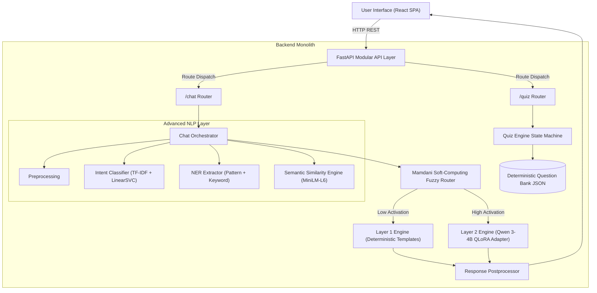

# ChatLab System Architecture Documentation

## Overview
ChatLab is a modular hybrid conversational AI monolith for Artificial Intelligence & Machine Learning question answering and interactive quizzes.

## High-Level System Architecture

## Data Flow
1. **Chat Mode Flow**:
   - User submits query -> Preprocessing -> Intent Classifier + Entity Extractor + Semantic Similarity.
   - Query Complexity & Entity Density calculated -> Mamdani Fuzzy Inference Engine computes Activation Score.
   - If Activation Score <= 0.50 -> Layer 1 Engine dispatches template response.
   - If Activation Score > 0.50 -> Layer 2 Engine generates contextual answer via fine-tuned Qwen model (or graceful pending state while training).
   - Response Postprocessor normalizes whitespace and length -> Returns payload to React UI.

2. **Quiz Mode Flow**:
   - User requests new quiz session -> QuizEngine selects questions from validated question bank -> Assigns session UUID.
   - User submits option choice -> QuizEngine evaluates correctness, updates score, returns explanation.
   - QuizEngine manages state until final question -> Returns score breakdown.
